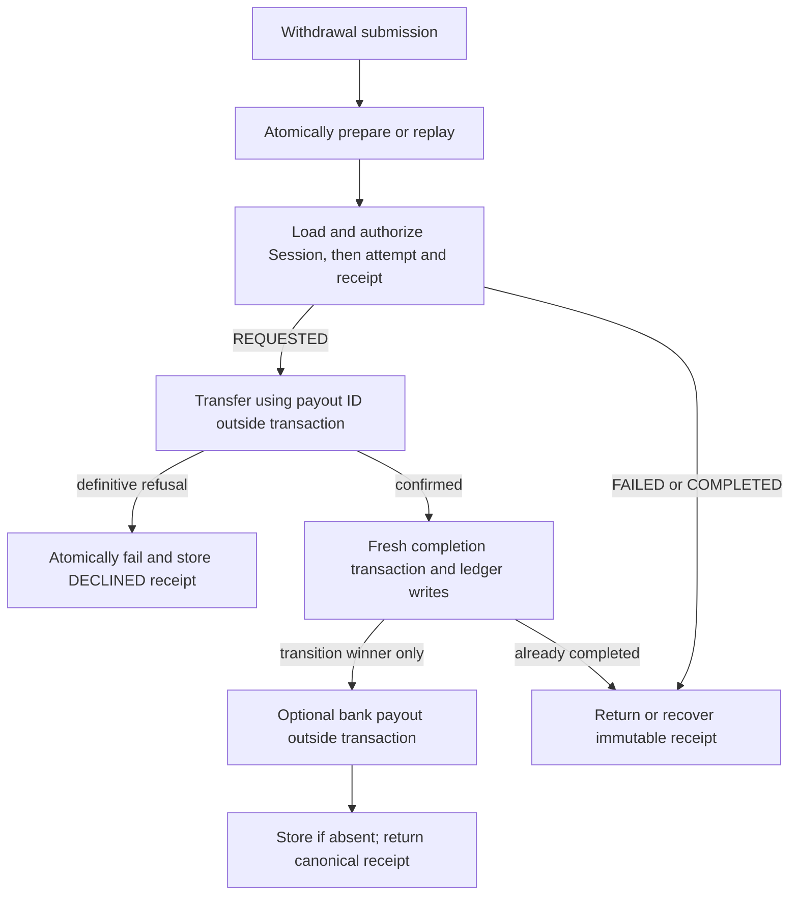

# ADR-0020: Payout request idempotency belongs to application transactions

- Status: Accepted
- Date: 2026-10-24
- Supersedes only payout client request-key ownership in ADRs
  [0003](./0003-aggregate-roots-and-boundaries.md),
  [0008](./0008-booker-behavior-and-session-lifecycle.md), and
  [0009](./0009-role-workflows-and-session-recording.md).

Client retries identify application submissions, whereas a payout ID identifies
one business attempt. Putting both in the domain conflated these responsibilities
and did not stop terminal retries from calling the provider again. The application
now owns submission replay and immutable terminal receipts. The domain retains
ownership, payout readiness, attendance, one pending attempt, payout-ID history,
frozen financial data, valid transitions, stale callbacks and rejection atomicity.
Wallet and ledger domain models remain unchanged.

`booker.preparePayout(session, { payoutId, now })` accepts no client request key.
Neither preparations, batches, requested intents, PayoutAttempt nor Session's
history expose those keys. The application-owned payout unit of work has two
operations:

- `prepare({ bookerId, sessionId, idempotencyKey }, work)` atomically claims and
  replays the preparation. Its key remains
  `["UC1-08:prepare", bookerId, sessionId, idempotencyKey]`, with the same stored
  preparation response and fingerprint as before.
- `transaction(stepKey, work)` always executes against fresh state. The key
  determines ledger-entry identities and never caches callback results or bank
  payout authorization.

Adapters privately retain the existing database key columns, uniqueness
constraints and pending-settlement JSON key. New payable preparations store the
real submission key. Resuming, completing and failing preserve that original
metadata, and nothing-to-pay adds no key history or attempt. Hydration validates
storage metadata but explicitly selects only domain fields. There is no migration
or backfill, and the HTTP request format stays compatible.

Transactions read receipts by payout ID and store them if absent, returning the
canonical stored value. Receipts use the existing idempotency table under
`["UC1-08:result", payoutId]`; submissions that resumed the same attempt share
one receipt. Before dispatch the application freshly loads and authorizes Session,
attempt and receipt, always locking Session before PayoutAttempt. Failed attempts
return their recorded DECLINED result. Newly failed attempts store that receipt
atomically with failure. Completed attempts return PAID without a provider call;
when recovering a legacy completion without a receipt, the bank method is omitted.
Conflicting provider outcomes still fail domain validation.

Only the invocation that transitions REQUESTED to COMPLETED may initiate the
optional bank payout. This authorization is an ephemeral return from a fresh
transaction. After the bank step, its actual result is stored only if no receipt
exists; otherwise the invocation returns the existing receipt. A concurrent
recovery can therefore establish a method-unknown PAID receipt while the winner
is paused, and both callers return that same immutable result.

Recovery favors avoiding another payment over guaranteeing an immediate bank
payout: after interruption an unstarted instant bank payout may fall back to
Stripe's standard schedule. The application paid result permits absent
`bankPayout`, matching the existing transport/OpenAPI schema, and the UI shows
neutral success. External calls remain outside transactions; Stripe's transfer
and bank-payout idempotency remain tied to payout ID.

The payout use-case regressions and
[production persistence suite](../../tests/integration/payout-persistence.test.ts)
cover terminal replay, reconstructed dependencies, concurrent submissions,
completion/recovery races, legacy metadata and rollback. Domain tests retain the
business guards independently of storage concurrency guarantees.
