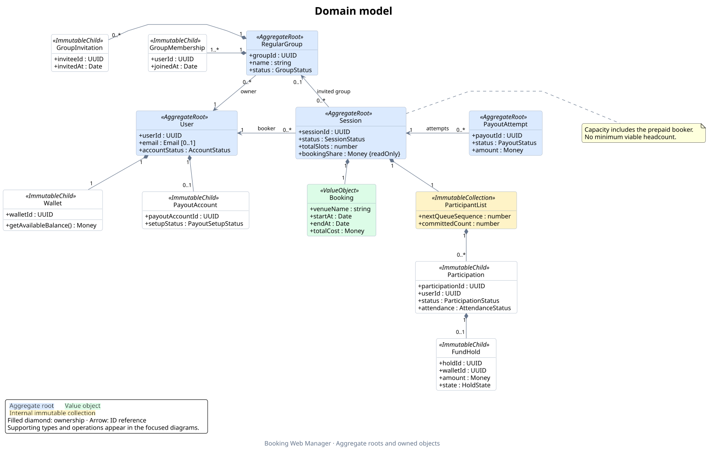

# Domain class diagram

These diagrams describe the current TypeScript domain in [`domain/`](../domain),
following [ADR-0003](./adr/0003-aggregate-roots-and-boundaries.md) and
[ADR-0009](./adr/0009-role-workflows-and-session-recording.md), with the collection
refinement in [ADR-0010](./adr/0010-session-participant-list.md). They document the
implementation; they do not introduce new domain behavior. These class diagrams
describe domain objects. An ID reference does not imply ownership or that the
referenced aggregate is loaded into the referring object.

- [Editable PlantUML source](./domain-class-diagram.puml)
- [Scalable SVG diagram](./assets/domain-class-diagram.svg)
- [PNG preview](./assets/domain-class-diagram.png)

Session's `bookingShare` is the immutable accepted per-slot price, rather than
a derived equal split. [ADR-0012](./adr/0012-booker-selected-session-pricing.md)
defines defaults, bounds and preservation of historical holds.



## Focused diagrams

The overview shows aggregate ownership and the main references between roots.
Operations, role views, values, and financial contracts are expanded below so
their connections can be read without lines crossing the entire domain.

| View | Covers | Diagram | Editable source |
| --- | --- | --- | --- |
| Accounts and groups | User, owned account objects, role views, and memberships | [SVG](./assets/domain-accounts.svg) | [PlantUML](./diagrams/domain-accounts.puml) |
| Sessions | Booking, participant list, participation, holds, and reliability | [SVG](./assets/domain-sessions.svg) | [PlantUML](./diagrams/domain-sessions.puml) |
| Settlement | Payout attempts and frozen settlement data | [SVG](./assets/domain-settlement.svg) | [PlantUML](./diagrams/domain-settlement.puml) |
| Ledger | Committed transactions, money, and balance queries | [SVG](./assets/domain-ledger.svg) | [PlantUML](./diagrams/domain-ledger.puml) |

## Reading the diagram

Blue classes are the four aggregate roots. Filled diamonds show logical
ownership; solid arrows show references, and dashed arrows show dependencies.
A dashed line with a hollow triangle shows interface implementation.
The focused diagrams include selected public properties and operations. They omit private
helpers, constructor/command argument types, most result contracts, status-union
definitions, and repetitive links to `Money`. Properties are exposed through
getters on classes and readonly fields on interfaces. Parameter types are
abbreviated.

- `Booker` and `Participant` wrap a `User`; they are role views, not subclasses.
  Creating or joining a session requires an active account with an email address;
  email confirmation is not required by the shared
  [booking account policy](../domain/accounts/booking-account-eligibility.ts).
  `emailVerified` records a separate identity provider fact.
- Booker owns complete creation, cancellation, visibility, removal, manual
  attendance, and settlement-preparation workflows. Participant owns joining,
  promotion, and voluntary-departure workflows, including eligibility and funding.
- Roles authorize actors and prepare immutable children and financial results.
  Session validates shared invariants and records those changes atomically. It
  does not import roles, call back into them, or reauthorize actors; applications
  enter actor workflows through the roles. Recording methods are not arbitrary
  roster setters.
- The Booking Room is represented by Session. It owns an internal immutable
  ParticipantList, which contains `0..*` participation records and queue state.
  `session.participantList` exposes only `ParticipantListView` queries; the focused
  diagram distinguishes that public interface from the internal implementation.
  Private maps and candidate-building methods are omitted.
  Active commitments plus reserved replacement seats are limited by `totalSlots`
  (at most eight). Departure chooses either one named replacement or the ordinary
  waitlist; that choice cannot change after withdrawal. See
  [ADR-0006](./adr/0006-personal-replacement-reservations.md).
  A direct invitation names one user ID and reserves the seat until that user
  explicitly accepts through `Participant.acceptReplacement`. Invitations do
  not use replacement links or automatically commit the recipient.
  This differs from the session's `roomToken`, which grants access through an
  ordinary private-session invitation link without reserving a named place.
  Waitlisted participation has no hold; a commitment requires one.
- ParticipantList is not another aggregate root. Session records a fully checked
  candidate list together with its status or settlement changes. The list owns
  capacity, FIFO, identity, and collection-transition validation; Session retains
  lifecycle/time guards and payout/batch cross-checks. Hydration still
  supplies participation arrays and a queue sequence through SessionDetails.
- `RegularGroup` has a member list that always includes its owner.
- Account policy functions are not additional aggregates. UC1-03 display-name
  and preference edits use the shared profile policy and guarded persistence
  without loading a complete `User`; the class's `updateProfile` method changes
  its email. Deactivation also shares an obligation policy with the narrow
  application workflow. See
  [ADR-0014](./adr/0014-account-policies-and-transaction-guards.md).
- `User` owns its wallet, but ledger history is external. `Wallet.getAvailableBalance()`
  derives spendable funds from the complete committed transaction collection.
  Saving a user does not rewrite that history. `WalletBalance` is a separate
  query result, not the wallet's hydration state.
- Reliability and group membership IDs are loaded related values. Calculating
  reliability reads participation outcomes and session end times without
  retaining that history. Participant reads its fully loaded User's values;
  Session receives prepared immutable children and reads no wallet/account state.
- `PayoutAttempt` owns frozen payout lines and a destination copy; it does not own
  live holds. `Booker.preparePayout` prepares the batch; Session validates and
  records it through `recordSettlementPreparation`, retaining its own pending
  copy. Failed attempts remain recorded, and each retry has a new payout ID.
  Frozen account references may
  outlive the user's current payout-setup child.
- ID attributes also express references where drawing another edge would add
  clutter: session to holding account; ledger entry to wallet/hold/payout;
  settled hold to payout; settlement line to participation/wallet/holding
  account; participation to the record it replaces. Optional ledger references
  are not asserted to be mandatory for particular transaction kinds.

## Source of truth

When changing a domain type, update its focused diagram and regenerate the
images in the same change. Check the overview when aggregate ownership or
cross-aggregate references change. The diagrams intentionally show selected
members, so omission of an operation does not mean it is unavailable.

| Diagram | Implementation to check |
| --- | --- |
| Overview and accounts | [`User`](../domain/accounts/user.ts), [`Booker`](../domain/accounts/booker.ts), [`Participant`](../domain/accounts/participant.ts), [`RegularGroup`](../domain/groups/regular-group.ts) |
| Sessions | [`Session`](../domain/sessions/session/session.ts), [`ParticipantList` / `ParticipantListView`](../domain/sessions/session/participant-list.ts), [`Participation`](../domain/sessions/participation.ts), [`FundHold`](../domain/sessions/fund-hold.ts) |
| Settlement | [`Booker.preparePayout`](../domain/accounts/booker.ts), [`PayoutAttempt`](../domain/finance/payout-attempt.ts), [financial contracts](../domain/shared/operations.ts) |
| Ledger | [`Wallet`](../domain/finance/wallet.ts), [`LedgerTransaction`](../domain/finance/ledger-transaction.ts), [`LedgerReadPort`](../domain/finance/ledger-read-port.ts), [`Money`](../domain/finance/money.ts) |

## Regenerate

From the repository root, using a local PlantUML installation:

```sh
rtk plantuml -tsvg -o assets docs/domain-class-diagram.puml
rtk plantuml -tpng -o assets docs/domain-class-diagram.puml
rtk plantuml -tsvg -o ../assets docs/diagrams/*.puml
```

Output directories are relative to each source file. All images are written to
`docs/assets/`; the overview also has a PNG preview. No application code changes
or network service are required to render them.
