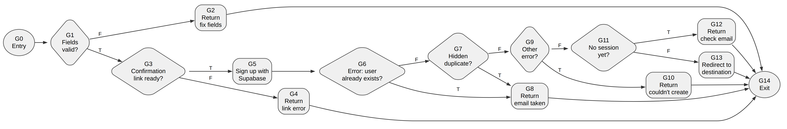
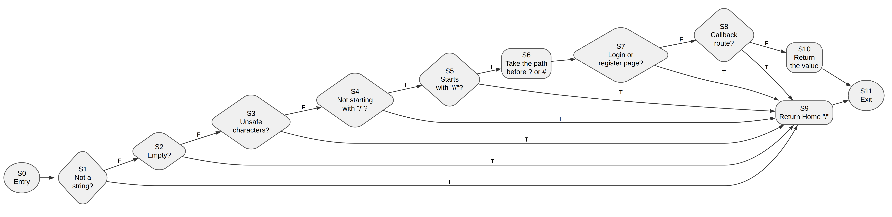
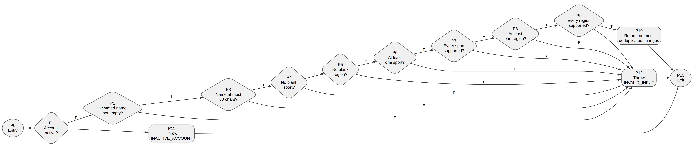

# Account and group black-box and white-box testing

[Download the editable Word report](account-testing-report.docx).

The report covers Joseph's UC1-01 registration, UC1-02 login, UC1-03 profile,
UC1-04 account deletion and UC1-06 regular groups. It contains 35 browser
scenarios, 40 executed black-box cases, five control-flow graphs (one per use
case) and 35 executed basis-path cases. The format follows the
[session testing report](../session-testing/README.md).

The browser scenarios were run on the production site on 20 October 2026:
**19 passed, 12 passed in part and 4 were blocked** (production confirms email
at sign-up, and the run created no money or sessions). The focused automated
run records **226 passing tests and 2 todo across 13 files**. No real
PostgreSQL row locking or Stripe call is claimed by this package.

## Browser run on production

The run used headless Chromium against <https://booking-web-manager.vercel.app>
with three test accounts and two test groups. All three accounts were deleted
through the app afterwards and both groups were archived. Each case's actual
output and result are in [manual-cases.json](manual-cases.json); the redacted
observations are in
[browser-run-20261020.json](evidence/production/browser-run-20261020.json),
with [screenshots](evidence/production/screenshots/). Invitation tokens, test
email addresses and passwords are left out.

Defects found:

| ID | Case | Defect | Status |
| --- | --- | --- | --- |
| D1 | UC1-02 | Pressing Log in before the page's JavaScript has loaded submits a plain GET, putting the email and password in the URL. The login and registration forms set no `method`. | Fixed: both forms now use `method="post"` |
| D2 | L05 | `/payouts` redirects to `/login` without `next`. | Fixed in PR #98 |
| D3 | M07 | Help does not link to Payouts. | Fixed in PR #98 |
| D4 | M01 | Settings shows no email address and has no Email or Payouts link. | Open |

G02's expected output was corrected after the run: the name field holds at most
60 characters, so a 61st character cannot be typed.

## Black-box tests (Lab 4 section 3.2.1)

The control class chosen for black-box testing is
[`deleteAccount`](../../../use-cases/accounts/delete-account.ts) (UC1-04). It
decides whether an account may be deleted from six obligation facts, so each
fact is tested at, just above and just below zero, with invalid values and
combinations.

| Use case | Subject | Cases | Test file |
| --- | --- | ---: | --- |
| UC1-04 | `deleteAccount` obligation checks | 21 | [delete-account-black-box.test.ts](../../../tests/lab4/delete-account-black-box.test.ts) |
| UC1-03 | `UpdateProfile` name, sports, regions and account state | 19 | [update-profile-black-box.test.ts](../../../tests/lab4/update-profile-black-box.test.ts) |

## White-box tests (Lab 4 section 3.2.2)

The lab asks for basis paths of two methods. This report covers one method per
use case, five in total.

| Use case | Subject | N | E | V = E - N + 2 | Editable source |
| --- | --- | ---: | ---: | ---: | --- |
| UC1-01 | `registerUser` server action | 15 | 20 | 7 | [DOT](figures/register-user-cfg.dot) |
| UC1-02 | `safeRedirectPath` | 12 | 18 | 8 | [DOT](figures/safe-redirect-path-cfg.dot) |
| UC1-03 | `prepareProfileUpdate` | 14 | 22 | 10 | [DOT](figures/prepare-profile-update-cfg.dot) |
| UC1-04 | `deleteAccount` use case | 12 | 15 | 5 | [DOT](figures/delete-account-cfg.dot) |
| UC1-06 | `ManageGroup.join` with `RegularGroup.join` | 11 | 14 | 5 | [DOT](figures/group-join-cfg.dot) |

### UC1-01 registerUser



Source: [registerUser](../../../app/(auth)/register/actions.ts). Six
decisions: fields valid, confirmation link ready, "user already exists" error,
hidden duplicate (no error and no identities), other error, and no session yet.
Supabase and the request headers are test doubles.

### UC1-02 safeRedirectPath



Source: [safeRedirectPath](../../../app/(auth)/redirect-path.ts). Seven
decisions, counting each operand of the three ORs separately. Paths S3 to S5 are
the open-redirect defences.

### UC1-03 prepareProfileUpdate



Source: [prepareProfileUpdate](../../../domain/accounts/profile.ts), the
policy `UpdateProfile` applies to every edit. Nine decisions, counting each
operand of the three ANDs separately; the preference loops are single
decisions.

### UC1-04 deleteAccount


Source: [deleteAccount](../../../use-cases/accounts/delete-account.ts). Four
decisions: the first obligation check, the re-check after deactivation, login
removal, and restoring the profile after a failure. Each `canDeactivate` call
counts as one decision; its six conditions are covered by the black-box table.

### UC1-06 joining a group


Source: [ManageGroup.join](../../../use-cases/groups/manage-group.ts) and
[RegularGroup.join](../../../domain/groups/regular-group.ts). Four decisions:
group found by token, group active, link active and matching, already a member.
The link check is one compound decision, because the group is looked up by its
token and a mismatched token cannot reach it through this entry point.

## Traceability and evidence

- [Manual test cases](manual-cases.json): the 35 browser scenarios with their
  actual output and result.
- [Production browser run](evidence/production/): redacted observations and
  screenshots.
- [White-box cases](white-box-cases.json): paths, inputs, expected outputs and
  results.
- [Graph manifest](figures/graphs.json): nodes, edges, source lines, path sets
  and the arithmetic checks. Graph arithmetic is not runtime coverage.
- Observations with expected and actual output:
  [deleteAccount](evidence/delete-account-black-box-observations.json),
  [UpdateProfile](evidence/update-profile-black-box-observations.json),
  basis paths for [deleteAccount and group join](evidence/account-basis-path-observations.json)
  and for [registerUser, safeRedirectPath and prepareProfileUpdate](evidence/auth-profile-basis-path-observations.json).
- [Focused run](evidence/) (`account-unit-*.json`, `.log` and `.metadata.json`):
  13 files, 226 passed, 2 todo.
- [PR validation](evidence/pr-validation/): full unit, typecheck and lint logs.

The two todos are existing placeholders in the UC1-03 and UC1-04 suites. The
UC1-03 one ("computes and displays the reliability score") matches a known gap:
Settings calculates the score from an empty history (fix proposed in PR #101).

## Reproduce

Run from the repository root:

```sh
npm ci
LAB4_EVIDENCE_DIR=docs/testing/account-testing/evidence \
  npx vitest run --project unit tests/lab4/delete-account-black-box.test.ts \
  tests/lab4/update-profile-black-box.test.ts tests/lab4/account-basis-path.test.ts \
  tests/lab4/auth-profile-basis-path.test.ts
npm test
npm run typecheck
npm run lint
```

The environment variable is optional; omit it to avoid rewriting the saved
observations.

To rebuild the Word document, use Python with `python-docx` and Pillow:

```sh
python3 docs/testing/account-testing/build_report.py
```

The graphs were rendered from their DOT sources with Graphviz (the
`@viz-js/viz` WebAssembly build). To regenerate one with a local Graphviz:

```sh
dot -Tpng -Gdpi=220 docs/testing/account-testing/figures/delete-account-cfg.dot \
  -o docs/testing/account-testing/figures/delete-account-cfg.png
```
