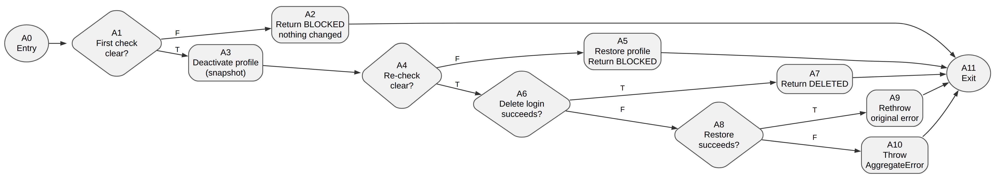
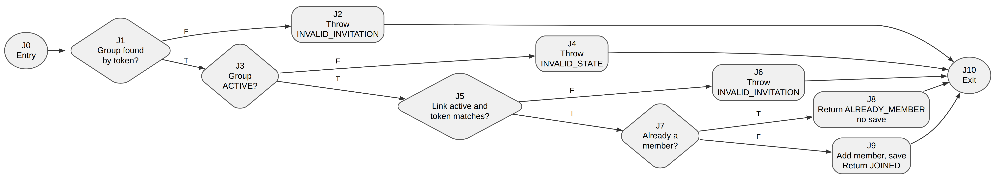

# Account and group black-box and white-box testing

[Download the editable Word report](account-testing-report.docx).

The report covers Joseph's UC1-01 registration, UC1-02 login, UC1-03 profile,
UC1-04 account deletion and UC1-06 regular groups. It contains 35 browser
scenarios, 40 executed black-box cases, two control-flow graphs and 10 executed
basis-path cases. The format follows the
[session testing report](../session-testing/README.md).

The browser scenarios are **Not run / Pending**. The focused automated run
records **201 passing tests and 2 todo across 12 files**. No browser, real
PostgreSQL, Supabase Auth or Stripe call is claimed by this package.

## Black-box tests (Lab 4 section 3.2.1)

The control class chosen for black-box testing is
[`deleteAccount`](../../../use-cases/accounts/delete-account.ts) (UC1-04). It
decides whether an account may be deleted from six obligation facts, so each
fact is tested at, just above and just below zero, with invalid values and
combinations.

| Use case | Subject | Cases | Test file |
| --- | --- | ---: | --- |
| UC1-04 | `deleteAccount` obligation checks | 21 | [delete-account-black-box.test.ts](../../../tests/lab4/delete-account-black-box.test.ts) |
| UC1-03 | `UpdateProfile` name, sports, regions and account state | 19 | [update-profile-black-box.test.ts](../../../tests/lab4/update-profile-black-box.test.ts) |

## White-box tests (Lab 4 section 3.2.2)

| Use case | Subject | N | E | V = E - N + 2 | Editable source |
| --- | --- | ---: | ---: | ---: | --- |
| UC1-04 | `deleteAccount` use case | 12 | 15 | 5 | [DOT](figures/delete-account-cfg.dot) |
| UC1-06 | `ManageGroup.join` with `RegularGroup.join` | 11 | 14 | 5 | [DOT](figures/group-join-cfg.dot) |

### UC1-04 deleteAccount



Source: [deleteAccount](../../../use-cases/accounts/delete-account.ts). Four
decisions: the first obligation check, the re-check after deactivation, login
removal, and restoring the profile after a failure. Each `canDeactivate` call
counts as one decision; its six conditions are covered by the black-box table.

### UC1-06 joining a group



Source: [ManageGroup.join](../../../use-cases/groups/manage-group.ts) and
[RegularGroup.join](../../../domain/groups/regular-group.ts). Four decisions:
group found by token, group active, link active and matching, already a member.
The link check is one compound decision, because the group is looked up by its
token and a mismatched token cannot reach it through this entry point.

## Traceability and evidence

- [Manual test cases](manual-cases.json): the 35 browser scenarios.
- [White-box cases](white-box-cases.json): paths, inputs, expected outputs and
  results.
- [Graph manifest](figures/graphs.json): nodes, edges, source lines, path sets
  and the arithmetic checks. Graph arithmetic is not runtime coverage.
- Observations with expected and actual output:
  [deleteAccount](evidence/delete-account-black-box-observations.json),
  [UpdateProfile](evidence/update-profile-black-box-observations.json),
  [basis paths](evidence/account-basis-path-observations.json).
- [Focused run](evidence/) (`account-unit-*.json`, `.log` and `.metadata.json`):
  12 files, 201 passed, 2 todo.
- [PR validation](evidence/pr-validation/): full unit, typecheck and lint logs.

The two todos are existing placeholders in the UC1-03 and UC1-04 suites. The
UC1-03 one ("computes and displays the reliability score") matches a known gap:
Settings calculates the score from an empty history.

## Reproduce

Run from the repository root:

```sh
npm ci
LAB4_EVIDENCE_DIR=docs/testing/account-testing/evidence \
  npx vitest run --project unit tests/lab4/delete-account-black-box.test.ts \
  tests/lab4/update-profile-black-box.test.ts tests/lab4/account-basis-path.test.ts
npm test
npm run typecheck
npm run lint
```

The environment variable is optional; omit it to avoid rewriting the saved
observations.

To rebuild the Word document, use Python with `python-docx` and Pillow:

```sh
python3 docs/testing/account-testing/build_report.py
```

The graphs were rendered from their DOT sources with Graphviz (the
`@viz-js/viz` WebAssembly build). To regenerate one with a local Graphviz:

```sh
dot -Tpng -Gdpi=220 docs/testing/account-testing/figures/delete-account-cfg.dot \
  -o docs/testing/account-testing/figures/delete-account-cfg.png
```
