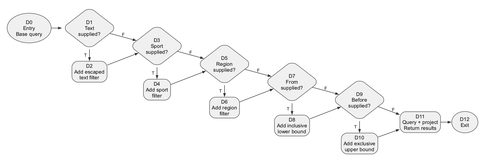
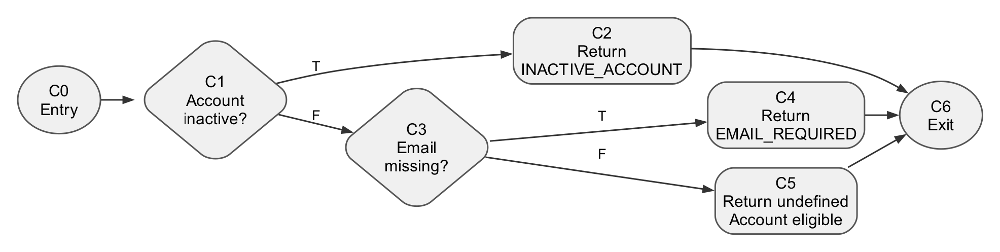
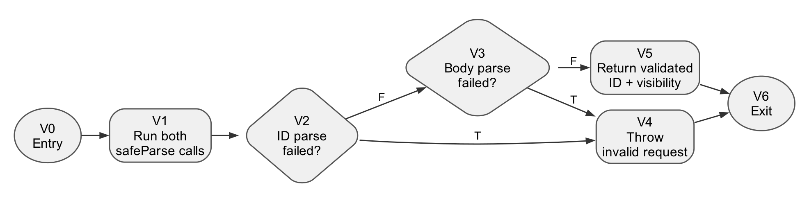
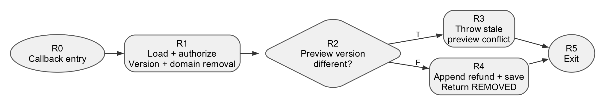
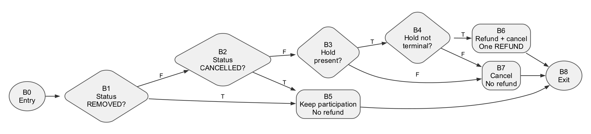

# Session black-box and white-box testing

[Download the editable Word report](session-testing-report.docx).

The report covers Neoh's UC2-01 discovery, UC2-02 creation, and UC2-03a/b/c
visibility, participant removal and session cancellation. It contains 40
browser/API scenario groups, five scoped control-flow diagrams, basis paths,
cyclomatic-complexity calculations and 46 executed creation boundary cases.
The test-table and path-diagram format follows the supplied senior's
`SRS.pdf` section 6.9. That reference's application behavior and pass results
are not requirements or results for this project.

Production checks on **20 October 2026** passed **2 smoke tests**, **19 public GET
checks**, **3 anonymous protected GET checks** and **7 browser checks**. These
suites contain overlapping assertions; their counts are not a unique-case total.
Of the 40 scenario groups, **2 passed, 4 are partial, 18 are blocked and 16 are
pending controlled execution or account setup**. Actual results and missing
prerequisites are recorded per row. The prepared test-account form still awaits
final Terms/Privacy acceptance; no production account or session was created.

The local focused evidence records **228 passing tests across 13 files**:
the original 223 checks plus five isolated discovery filter tests. Earlier PR validation records
**2,458 passing tests, 33 skipped and 2 TODO**, with type checking and lint passing.
The original focused tests are included in that earlier full-suite total; do not
add the totals. The new five-test selection is recorded separately. No
authenticated production mutation, payment-provider execution or instrumented
coverage measurement is claimed.

## Diagrams

Each PNG has an editable Graphviz source beside it. The graph's scope matters:
these are selected implementation functions or blocks, not a complexity value
for an entire use case. Shared domain helpers support these use cases without
being attributed exclusively to the session feature owner.

| Use case | Subject | N | E | V = E - N + 2 | Editable source |
| --- | --- | ---: | ---: | ---: | --- |
| UC2-01 | Discovery SQL filter construction | 13 | 17 | 6 | [DOT](figures/discovery-cfg.dot) |
| UC2-02 | Creation account-policy helper | 7 | 8 | 3 | [DOT](figures/creation-cfg.dot) |
| UC2-03a | Visibility input parser | 7 | 8 | 3 | [DOT](figures/visibility-cfg.dot) |
| UC2-03b | Removal confirmation callback | 6 | 6 | 2 | [DOT](figures/removal-cfg.dot) |
| UC2-03c | Cancellation preparation helper | 9 | 12 | 5 | [DOT](figures/cancellation-cfg.dot) |

### UC2-01 discovery



Source: [PostgresSessionDiscoveryReader.search](../../../lib/sessions/postgres-session-discovery-reader.ts).
Five source-level filter guards give six independent paths: no filters, then
one optional filter at a time. Existing tests include a no-filter case and
combined-filter cases. Five new isolated one-filter cases passed locally,
verifying exact SQL predicates and bound parameters with a recording executor.
SQL execution and row-mapping internals are outside the graph.

### UC2-02 creation



Source: [bookingAccountIneligibility](../../../domain/accounts/booking-account-eligibility.ts).
Inactive account, missing email and eligible account are the three paths.
Payout readiness, price, time, capacity and persistence are separate checks.

### UC2-03a visibility



Source: [parseSessionVisibilityInput](../../../app/sessions/visibility-input.ts).
Both schema parsers run before the condition. The two operands of the
short-circuit OR are counted separately. Downstream ownership, lifecycle and
capacity checks are excluded from this parser's graph.

### UC2-03b removal



Source: [RemoveParticipant](../../../use-cases/sessions/RemoveParticipant.ts).
The graph covers the inner confirmation callback only. Domain preparation
precedes the version check. A stale-version test must assert unchanged
persisted state, not the absence of tentative in-memory mutation.

### UC2-03c cancellation



Source: [Booker.prepareCancellation](../../../domain/accounts/booker.ts).
The graph expands atomic short-circuit predicates. The five concrete basis
cases preserve terminal history, handle no hold or an already-refunded hold,
and refund a live held share once. The caller's participant loop is excluded.

## Traceability and evidence

- [Manual test cases](manual-cases.json) contain the 40 scenario groups.
- [White-box cases](white-box-cases.json) contain paths, inputs, expected outputs
  and execution status.
- [Graph manifest](figures/graphs.json) contains complete nodes, edges, source
  lines, path sets and arithmetic audits. Graph arithmetic is not runtime
  coverage.
- [Creation observations](evidence/testing-black-box-observations.json) record
  all 46 expected/actual comparisons.
- [Cancellation observations](evidence/testing-booker-observations.json) record
  five expected/actual state and instruction comparisons.
- [Focused run](evidence/current-session-unit-20261020T075208Z.json):
  153 tests in seven files.
- [Boundary run](evidence/current-session-boundary-unit-20261020T075359Z.json):
  70 tests in five files.
- [PR validation](evidence/pr-validation/) contains the full unit, typecheck and
  lint logs and exit-code metadata.
- [Production execution summary](evidence/production/execution-summary.json)
  records the observed live results and fixture limitations.
- [Public GET matrix](evidence/production/public-get-checks-20261020T081609Z.md),
  [browser observations](evidence/production/browser-observations.json) and
  [protected reads](evidence/production/anonymous-protected-get-checks.json)
  retain the production evidence. Discovery was empty during the run, so matching,
  exact time filtering and pagination were not established.
- [New local discovery basis evidence](evidence/production-validation-local/)
  retains the five additional tests. This directory is local validation performed
  during the production report update, not production white-box execution.

The focused runs used implementation revision
`135064c0244fc684c9773ff947d8bf44e60f085e`. Relevant production source and the
existing focused tests are unchanged at PR base
`7aacdc97e2ab7d72724429b13eb7f17ee398010b`. The three report-specific test files are
included under `tests/lab4/`; other local Lab 4 deliverables are outside this
change. The deployed production Git revision was not verified. Local test
snapshots and live observations remain separate evidence.

## Reproduce

Install the repository's locked Node 22 dependencies first. Run from its root:

```sh
rtk npm ci
rtk env LAB4_EVIDENCE_DIR=docs/testing/session-testing/evidence \
  npm test -- tests/lab4
rtk npm test
rtk npm run typecheck
rtk npm run lint
```

The environment variable is optional; omit it to avoid rewriting saved
observations. `tests/lab4` contains 46 creation partition/boundary cases, five
cancellation basis cases and five isolated discovery-filter cases. The
timestamped focused metadata records the original 12-file selection.

For the read-only production checks:

```sh
rtk env PRODUCTION_URL=https://booking-web-manager.vercel.app npm run test:e2e:production
rtk python3 docs/testing/session-testing/evidence/production/public_get_checks.py
```

The public script saves timestamped results beside the script. Do not
point the disposable database integration harness at production. Exact clock
boundaries and injected rollback scenarios require a controlled environment.

To rebuild the Word document, use Python with `python-docx` and Pillow:

```sh
rtk python3 docs/testing/session-testing/build_report.py
```

To regenerate a diagram with Graphviz:

```sh
rtk dot -Tpng -Gdpi=220 \
  docs/testing/session-testing/figures/discovery-cfg.dot \
  -o docs/testing/session-testing/figures/discovery-cfg.png
```

The document's tables and text are editable in Word. Diagrams are embedded PNGs;
edit their DOT sources and rebuild to change them. Rendered review PDFs and page
images are local QA intermediates and are not part of the committed report.
