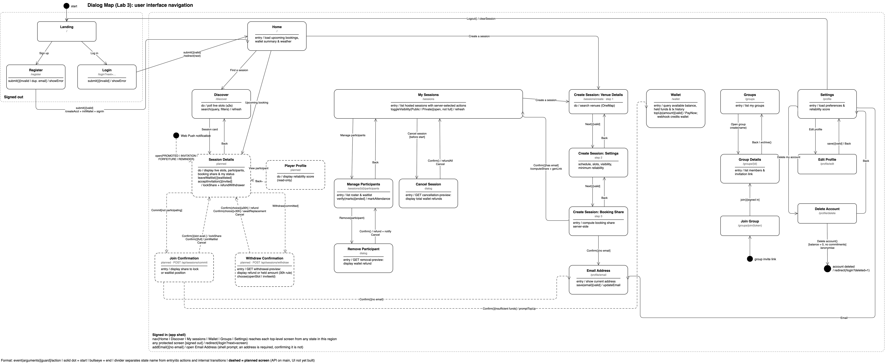

# Lab 3

| Deliverable | Author | Files |
| --- | --- | --- |
| Use case model: UC2-04 Commit to Session, UC2-05 Withdraw from Session, UC2-06 Verify Attendance | Yajie Wang | [use-cases/](./use-cases/) |
| Dialog map | Yajie Wang | [docs/diagrams/dialog-map/](../docs/diagrams/dialog-map/README.md) |

Diagrams live in [docs/diagrams/](../docs/diagrams/README.md) with every other
project diagram; this folder links to them.

## Use case model (UC2-04, UC2-05, UC2-06)

- [uc2-04-05-06-descriptions.md](./use-cases/uc2-04-05-06-descriptions.md): the three use case descriptions as submitted in the SRS (last updated 19/10/2026).
- [uc2-session-management.png](../docs/diagrams/use-case/uc2-session-management.png): the UC2 (session management) use-case diagram from the SRS. It is shared with UC2-01 to UC2-03; Commit to Session, Withdraw from Session and Verify Attendance are the parts covered here.

## Dialog map

The user-interface navigation map, drawn as a UML state machine. Its
exports, editable draw.io sources and regeneration steps are in
[docs/diagrams/dialog-map/](../docs/diagrams/dialog-map/README.md).

